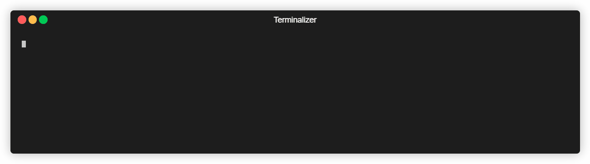

# Create HTML5 Boilerplate

Quick start for HTML5 Boilerplate. Get up and running with one command.

## Getting Started

You can get started using one of three options- `npx`, `npm init`, or
`yarn create`

Using `npx`

```
npx create-html5-boilerplate new-site
cd new-site
npm install
npm start
```

Using `npm init`

```
npm init html5-boilerplate new-site
cd new-site
npm install
npm start
```

Using yarn

```
yarn create html5-boilerplate new-site
cd new-site
yarn install
yarn start
```

These commands are equivalent and do the following:

1. Download and install the latest version of HTML5 Boilerplate
2. Installs dependencies
3. Bundles site assets and start a web server using [Parcel](https://parceljs.org/)
4. Opens a web browser pointed to http://localhost:1234/

## Requirements

`create-html5-boilerplate` is cross-platform and requires Node.js 20.0.0 or
newer. Node.js 20, 22 and 24 are tested in CI. You can also install the project
globally:

```
npm install -g create-html5-boilerplate
```

Then you can use `create-html5-boilerplate` as in the following example

```
create-html5-boilerplate new-site
cd new-site
npm install
npm start
```

## Installing Specific Versions

You can also install a specific version:

```
npx create-html5-boilerplate new-site --release=7.2.0
cd new-site
npm install
npm start
```

## CONTRIBUTING

### Setting Up a Local Copy

1. Clone the repo with `git clone https://github.com/h5bp/create-html5-boilerplate.git`
2. Run `npm ci` in the root `create-html5-boilerplate` folder.
3. Run `npm link` to make npm run local copy instead of downloading from registry
4. Now you can use `npm init html5-boilerplate` and `npx create-html5-boilerplate`

note: you can use `npx create-html5-boilerplate ./out/example` from `create-html5-boilerplate` without running `npm link`
also its possible to run directly NodeJS entry point `node index.js ./out/example` or `npm start`
`./out` is git ignored folder, so you should use this folder for tests.

If you want to try out the end-to-end flow with the global CLI, you can do this too:

```
npx create-html5-boilerplate ./out/new-site
cd new-site
npm install
npm start
```

### Tests

Tests use the [Node.js test runner](https://nodejs.org/api/test.html) and are
located in `tests/test.js`. They download published HTML5 Boilerplate versions
from the npm registry and use isolated temporary directories to run in parallel.

Run `npm test`, `npm run test:watch`, or `npm run coverage`. Run `npm run lint`
and `npm run format:check` to check the code, or `npm run format` to format it.
`npm run prepare` installs the Husky hook for formatting staged files.

### Dependency upgrade notes

The `pacote` upgrade from 17 to 21 is a major change; version 22 requires newer
Node 22 and 24 patch releases than this project's minimum. The unused direct
`npm` dependency and Jest runner were removed. The flat ESLint configuration
replaces Airbnb's legacy configuration with the recommended ESLint and import
rules plus Prettier; it does not preserve every Airbnb rule.

Further major upgrades of Chalk, Ora, and yargs-parser should be reviewed for
API and output changes. Inquirer is intentionally kept at 9 because
`inquirer-autocomplete-prompt` requires it; upgrading requires a prompt migration.
`fuzzy`, `elapsed-time-logger`, and the autocomplete prompt have not had recent
releases and should be evaluated for replacement separately to avoid changing
CLI behavior in this baseline update.

The production dependency audit on November 10, 2026 reported 15 moderate and
one high advisory, including transitive dependencies of `pacote` and `picomatch`.
Run `npm audit --omit=dev` for current details; further remediation needs review
against the supported Node versions and CLI compatibility.
